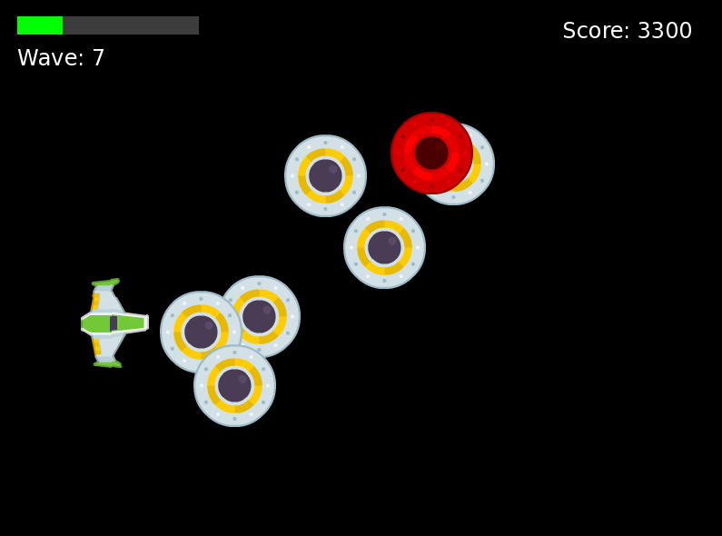
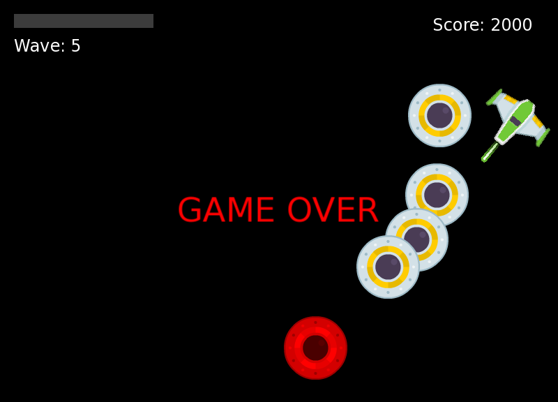

# Survival Protocol

A 2D top-down survival shooter developed in **C++20** using **SFML 3**.

The player must survive increasingly difficult waves of enemies, using movement and shooting to avoid damage and defeat opponents.

## Gameplay

## In-game

## Game Over

## Features

- **Wave-based enemy spawning** with increasing difficulty
- **Three enemy types:** Normal, Fast and Tank
- **Enemy AI:** Enemies move towards the player's position
- **Distance-constrained spawning:** Enemies spawn away from the player
- **Combat system:** Projectiles, collision detection, damage and health
- **Scoring system** and on-screen HUD
- **Game states:** Playing, Game Over and restart functionality

## Technical Implementation

The project uses object-oriented C++ and separates gameplay responsibilities into dedicated classes:

| Component | Responsibility |
|---|---|
| `Game` | Main game loop, input handling, collision detection and rendering |
| `Player` | Player movement, health and shooting direction |
| `Enemy` | Enemy behaviour, movement and damage |
| `Projectile` | Projectile movement and collision behaviour |
| `WaveManager` | Enemy spawning, wave progression and state transitions |
| `EnemyConfig` | Configuration for different enemy types |

### Key Programming Concepts

- Object-oriented programming and encapsulation
- State-machine-based wave management
- Delta-time-based updates
- Standard library containers and algorithms
- Random number generation with `std::mt19937`
- Vector mathematics and collision detection
- Separation of gameplay systems into reusable components

## Technologies

- C++20
- SFML 3
- Visual Studio 2022
- Git and GitHub

## Building the Project

The project was developed on Windows using Visual Studio 2022.

Requirements:
- A C++20-compatible compiler
- SFML 3
- Visual Studio with C++ desktop development tools

To build:
1. Clone or download the repository.
2. Install a compatible SFML 3 distribution.
3. Open the Visual Studio solution.
4. Configure the SFML include and library directories for your installation.
5. Link the appropriate SFML libraries for Debug or Release.
6. Ensure the required SFML runtime DLLs are available.
7. Build and run the project.

**Note:** The project currently uses local SFML installation paths in its Visual Studio configuration, which may need adjusting on another computer.

## Controls

- **Movement:** Keyboard
- **Aim:** Mouse
- **Shoot:** Spacebar
- **Restart after Game Over:** R

## Future Improvements

- Sound effects and background music
- Improved enemy behaviours
- Additional weapons and power-ups
- Difficulty balancing and gameplay polish

## About

This project was developed as part of my C++ gameplay programming learning journey, with a focus on building a complete playable game and practising software design, game loops, object-oriented programming and state management.